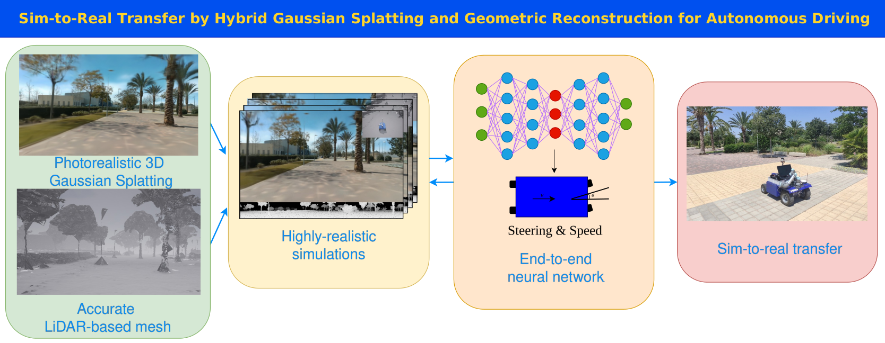

<div align="center" style="list-style: none;">

 # Sim-to-Real Transfer by Hybrid 3D Gaussian Splatting and LiDAR Reconstruction for Autonomous Driving <br>[Paper](https://www.sciencedirect.com/science/article/pii/S0952197626006536) | [Project](https://aurova-projects.github.io/Sim2Real/)

</div>

[](https://www.youtube.com/embed/YhrxIjJJjGE?si=qaoPQPfXu_ZE_7iF)


## Installation

System requirements: Ubuntu 24.04 and ROS 2 Jazzy. We have migrated this repository to ROS 2, but we have not yet updated our changes in CARLA to the version for Ubuntu 24.04 and Unreal Engine 5.

1. Install AUROVA planning and localization (skip this step if you want only to use the end-to-end local planner, although you must edit some files).
    - External libraries: [ceres-solver-2.0.0](http://ceres-solver.org/installation.html) (IMPORTANT!! version 2.0.0). Eigen and PCL are usually installed join with ROS.
    ```
    cd INSTALLATION/PATH/LIBRARIES
    git clone https://ceres-solver.googlesource.com/ceres-solver --branch 2.0.0
    sudo apt update
    sudo apt-get install cmake libgoogle-glog-dev libgflags-dev libatlas-base-dev libeigen3-dev
    mkdir ceres-bin
    cd ceres-bin
    cmake ../ceres-solver
    make -j7
    sudo make install
    ```
    - Local libraries: [lib_localization](https://github.com/AUROVA-LAB/lib_localization) and [lib_planning](https://github.com/AUROVA-LAB/lib_planning).
    ```
    cd INSTALLATION/PATH/LIBRARIES
    git clone https://github.com/AUROVA-LAB/lib_localization
    cd lib_localization/
    mkdir build
    cd build
    cmake .. 
    make
    sudo make install
    cd ../../

    git clone https://github.com/AUROVA-LAB/lib_planning
    cd lib_planning/
    mkdir build
    cd build
    cmake .. 
    make
    sudo make install
    ```
    - External ROS packages: 
    ```
    sudo apt-get install ros-jazzy-ackermann-\* ros-jazzy-robot-state-\* ros-jazzy-xacro 
    ```
    - Local ROS packages: [robot_blue](https://github.com/AUROVA-LAB/robot_blue), [aurova_preprocessed](https://github.com/AUROVA-LAB/aurova_preprocessed), [aurova_odom](https://github.com/AUROVA-LAB/aurova_odom), [aurova_detections](https://github.com/AUROVA-LAB/aurova_detections), [aurova_localization](https://github.com/AUROVA-LAB/aurova_localization), and [aurova_planning](https://github.com/AUROVA-LAB/aurova_planning).
    ```
    cd PATH/TO/aurova_ws/src
    git clone https://github.com/AUROVA-LAB/robot_blue --branch ros2
    git clone https://github.com/AUROVA-LAB/aurova_preprocessed --branch ros2
    git clone https://github.com/AUROVA-LAB/aurova_odom --branch ros2
    git clone https://github.com/AUROVA-LAB/aurova_detections --branch ros2
    git clone https://github.com/AUROVA-LAB/aurova_localization --branch ros2
    git clone https://github.com/AUROVA-LAB/aurova_planning --branch ros2

    cd ..
    colcon build --symlink-install --cmake-args -DCMAKE_BUILD_TYPE=Release --packages-up-to app_geo_navigation 
    ```
    - Ground boundaries detection (whole localization pipeline)
    ```
    cd PATH/TO/aurova_ws/src/aurova_detections/yolinov2_ros
    docker build -t yolinov2:jazzy .
    ```
5. Follow the instructions of [aurova_reconstruction/hybrid_3dgs_mesh](https://github.com/AUROVA-LAB/aurova_reconstruction/tree/ros2/hybrid_3dgs_mesh) to build the simulated environments from real-world data.
6. Install the [Sim2Real_local_planner](https://github.com/AUROVA-LAB/aurova_planning/tree/ros2/Sim2Real_local_planner).
    - Compile the code to process the dataset and generate the safety matrices for training the model:
    ```
    cd PATH/TO/CATKIN_WS/src/aurova_planning/Sim2Real_local_planner/process_data
    mkdir build
    cd build
    cmake ..
    make
    ```

    - Build the Docker image:
    ```
    cd PATH/TO/CATKIN_WS/src/aurova_planning/Sim2Real_local_planner
    docker build -t aurova_sim2real .
    ```

    - For using the neural network in the real robot, build the Docker image with ROS:
    ```
    cd PATH/TO/CATKIN_WS/src/aurova_planning/Sim2Real_local_planner
    docker build -f Dockerfile.ros -t aurova_sim2real:ros2 .
    ```

## Usage

Dataset generation with CARLA and Unreal Engine 5 is not migrated yet.

## Training
For training the end-to-end neural network, run the Docker image:
```
docker run --gpus all --rm -it --shm-size=500gb --ulimit memlock=-1 --ulimit stack=67108864 -v PATH/TO/CATKIN_WS/aurova_planning/Sim2Real_local_planner/:/Sim2Real -v PATH/TO/DATASET/:/dataset --name aurova_sim2real aurova_sim2real
```

Configure the `config.py` file to select the training scenes (adding *scene1* to the list, the network will be trained with all the folders that start with *scene1*) and set your `rgb_images` folder. Then, start the training:

```
cd Sim2Real/
python train.py --id EXPERIMENT_NAME --save_k 3 --num_workers 12 --batch_size 8 --model safety
```

## Usage
### Real robot
For using the end-to-end neural network in our UGV, BLUE,  run the Docker image of [Sim2Real_local_planner](https://github.com/AUROVA-LAB/aurova_planning/tree/master/Sim2Real_local_planner) for ROS:
```
docker run --rm --gpus all --ipc=host --ulimit memlock=-1 --ulimit stack=67108864 -it --privileged -v PATH/TO/TRAINED_MODEL:/home/ubuntu/aurova_ws/src/Sim2Real/model.pth --name sim2real aurova_sim2real:ros2

```

In other terminal, launch the rest of the nodes:

```
ros2 launch Sim2Real_local_planner nav_network_GeoLoc_online.xml
```

Wait until the vehicle is localized and send "2D Nav Goal" from rviz to start autonomous navigation. The followed route is defined in `params/nav_network_GeoLoc_online.yaml`. In other terminal run the docker for ground boundaries detection (whole localization pipeline):

```
docker run --rm --gpus all --ipc=host --ulimit memlock=-1 --ulimit stack=67108864 -it --privileged --name yolinov2 yolinov2:jazzy
```

For evaluation, save a rosbag with the /localization and /CLEAR_status topics. In our work, we get the ground truth trajectory using the NVP local planner, which is the expert for our models.

## Evaluation
The trajectories are evaluated with the script `trajectory_evaluation.py`, comparing them with the ground truth trajectory.  This script calculates the Dynamic Wrapping Time (DWT) between both trajectories to measure their similarity, the time ratio between ground truth and the evaluated trajectory, and the number of interventions made by the human operator.

#### Utils

There are several Python scripts in [scripts](./scripts) folder:

- `joystick_keymap.py`: Displays current joystick key mapping. Modify global variables in Python scripts to configure controls.
- `record_rosbag_data.py`: Used to get the dataset from trajectories performed with the real robot.
- `compress_rosbag.py`: Reduces the rosbag size discarting the images and LiDAR data.
- `crop_rosbag.py`: Crop a rosbag, used to evaluate each lap of the long test routes.

## Citation
If you find our code or papers useful, please cite:
```
@article{olivas2026eaai,
    title = {Sim-to-real transfer by hybrid Gaussian Splatting and geometric reconstruction for autonomous driving},
    author = {Alejandro Olivas and Miguel Ángel Muñoz-Bañón and Fernando Torres},
    journal = {Engineering Applications of Artificial Intelligence},
    volume = {172},
    pages = {114372},
    year = {2026},
    issn = {0952-1976},
    doi = {https://doi.org/10.1016/j.engappai.2026.114372},
    url = {https://www.sciencedirect.com/science/article/pii/S0952197626006536},
}
```

