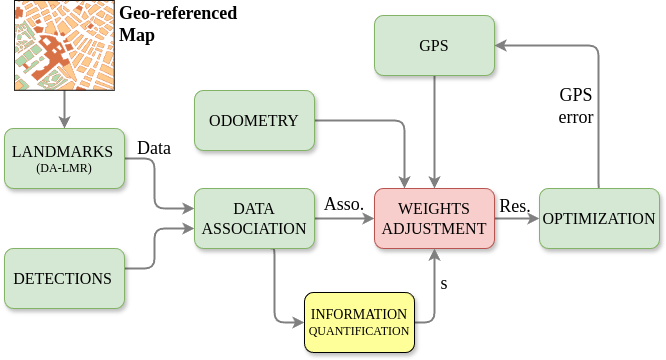

# Geo-Localization
This repository presents the code for replicating the whole pipeline presented in the works: [Geo-Localization Based on Dynamically Weighted Factor-Graph](https://aurova-projects.github.io/geo-localization_weighted/) + [Robust Self-Tuning Data Association for Geo-Referencing Using Lane Markings](https://aurova-projects.github.io/geo-localization_self-tunning/)

**Note:** A version of the pipeline, including path planning, is [here](https://github.com/AUROVA-LAB/applications/tree/main/app_geo_navigation)




Citations:
``` 
@article{munoz2024geolocalization,
          title={Geo-Localization Based on Dynamically Weighted Factor-Graph},
          author={Muñoz-Bañón, Miguel Ángel and Olivas, Alejandro and Velasco-Sánchez, Edison and Candelas, Francisco A. and Torres, Fernando},
          journal={IEEE Robotics and Automation Letters},
          volume={9},
          number={6},
          pages={5599--5606},
          year={2024},
          doi={10.1109/LRA.2024.3396055},
          publisher={IEEE}
        }

@article{munoz2022robust,
          title={Robust Self-Tuning Data Association for Geo-Referencing Using Lane Markings},
          author={Muñoz-Bañón, Miguel Ángel and Pauls, Jan-Hendrik and Hu, Haohao and Stiller, Christoph and Candelas, Francisco A. and Torres, Fernando},
          journal={IEEE Robotics and Automation Letters},
          volume={7},
          number={4},
          pages={12339--12346},
          year={2022},
          doi={10.1109/LRA.2022.3216991},
          publisher={IEEE}
        }
```

## Installation instructions to replicate

### Requirements to use application:
These repository has migrated to ROS 2, the version of ROS 1 is in the main branch.
- System requirements: Ubuntu 24.04 and ROS Jazzy. 
- External libraries: [ceres-solver-2.0.0](http://ceres-solver.org/installation.html) (IMPORTANT!! [download](https://drive.google.com/file/d/1acZtn_jaHfj2BVgwaDnQH2Lz-7022F1-/view?usp=share_link) version 2.0.0). Eigen and PCL are usually installed join with ROS.
- Local libraries: [lib_localization](https://github.com/AUROVA-LAB/lib_localization) and [lib_planning](https://github.com/AUROVA-LAB/lib_planning).
- External ROS packages: "sudo apt-get install ros-jazzy-ackermann-\*", "sudo apt-get jazzy ros-noetic-robot-state-\*".
- Local ROS packages (checkout the ros2 branch): [robot_blue](https://github.com/AUROVA-LAB/robot_blue), [aurova_preprocessed](https://github.com/AUROVA-LAB/aurova_preprocessed), [aurova_odom](https://github.com/AUROVA-LAB/aurova_odom), [aurova_detections](https://github.com/AUROVA-LAB/aurova_detections), and [aurova_localization](https://github.com/AUROVA-LAB/aurova_localization).

### Docker usage
In "applications" there is a Dockerfile for installation in others OS. Download the local packages (checkout the ros2 branch), and build the docker image:
```
  cd /PATH/TO/aurova_ws/applications
  docker build -t ros2-jazzy .
```

Run the Docker image, sharing the correspondig directories:
```
docker run --rm --gpus all --ipc=host --ulimit memlock=-1 --ulimit stack=67108864 -it --privileged -e DISPLAY=$DISPLAY -v /tmp/.X11-unix:/tmp/.X11-unix:rw -v /dev:/dev -v /PATH/TO/aurova_ws:/home/ubuntu/aurova_ws -v /PATH/TO/rosbag:/PATH/TO/rosbag --name ros2-jazzy ros2-jazzy
```

For opening a new terminal in the docker:
```
docker exec -it ros2-jazzy /ros_entrypoint.sh "/bin/bash"
```

### Steps to use application (offline mode via rosbag):

- [Download](https://drive.google.com/file/d/1oW7MLIJhvlNtgJsetXNRY-BQxufgPUoJ/view?usp=sharing) bag file for this example.
- Modify "launch/nav_GeoLoc_offline.xml" to provide correct link in "bag_file_1" argument.
- Modify "params/nav_GeoLoc_offline.yaml" to provide correct link in "url_to_map" variable.
- Run next command for localization (Odometry + GPS):

```shell
ros2 launch app_geo_localization nav_GeoLoc_offline.xml
```
- Follow the instructions [here](https://github.com/AUROVA-LAB/aurova_detections/tree/main/yolinov2_ros) (in the example section and in ros2 branch) to run the docker for ground boundaries detection (whole localization pipeline).

### Steps to use application (online mode via BLUE robot) **Not migrated yet**:

- Modify "params/nav_GeoLoc_online.yaml" to provide correct link in "url_to_map" variable.
- Run next command for localization:

```shell
ros2 launch app_geo_localization nav_GeoLoc_online.launch
```
- Follow the instructions [here](https://github.com/AUROVA-LAB/aurova_detections/tree/main/yolinov2_ros) (in the example section) to run the docker for ground boundaries detection (whole localization pipeline).
- Drive!!
